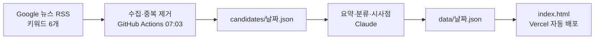

# Pay Brief — 결제·핀테크 데일리 브리프

결제·핀테크 뉴스를 매일 아침 07:00 마감으로 모아 중복을 걸러내고, 기사마다 **요약 + 상품기획팀이 검토할 점(시사점)**을 붙여 한 페이지로 보여 주는 서비스.

- 라이브: https://briefpage-tau.vercel.app
- 역할: 기획 · 요구사항 정의 · 데이터 파이프라인 설계 · 운영 (1인 프로젝트, 구현은 Claude Code와 협업)


## 왜 만들었나

결제·PG·정산·스테이블코인·AI 에이전트 결제 쪽 뉴스는 매일 수십 건씩 나오지만, 같은 발표를 다룬 기사가 제목만 바꿔 여러 번 올라오고 홍보성 기사도 섞여 있다. 상품기획자가 아침에 필요한 건 기사 목록이 아니라 다음 세 가지다.

1. **오늘 볼 만한 것만** — 중복·무관 기사 제거
2. **분야별로 나눠서** — 결제·PG / 정산·송금 / AI·에이전트 / 규제·정책 / 경쟁사·시장
3. **"그래서 우리는 뭘 검토해야 하나"** — 기사마다 시사점 1문장

## 동작 방식



| 단계 | 하는 일 | 파일 |
|---|---|---|
| 수집 | 키워드 6개 RSS → 전날 07:00 ~ 당일 07:00 기사만 → 제목 핵심어·광고어 필터 | `scripts/build-brief.js` |
| 중복 제거 | ① 링크 정규화 ② 제목 앞 30자 일치 ③ 제목 2글자 조각 60% 이상 겹침, 또는 같은 주어 + 35% 이상 → 최신 1건만 | 〃 |
| 요약 | 제목·설명만 보고 분야·요약(40자 이내)·시사점·중요도(1~3)·관련성 판단. 설명에 없는 사실은 쓰지 않음 | 〃 `buildPrompt()` |
| 저장 | 브리프 날짜·실제 수집 구간·핵심 3건·기사 목록을 JSON으로 | `data/YYYY-MM-DD.json` |
| 화면 | 핵심 3건, 분야 탭, 기사 카드, 지난 브리프 선택 | `index.html` (빌드 없는 정적 페이지) |

## 기획에서 정한 것들

- **"하루치"의 정의**: 브리프 D = 전날 07:00 ~ D 07:00 (KST). 출근 전에 읽는 아침 브리프라 내용은 대부분 전날 낮~저녁 기사다. 몇 시에 다시 돌려도 같은 날짜에는 같은 구간이 나오도록 실행 시각과 분리했다.
- **양보다 정리**: 키워드별 최대 6건, 하루 최대 30건. 같은 사건은 1건만 남긴다.
- **저작권**: 기사 본문은 가져오지 않고 제목·링크와 자체 요약만 보여 준다.
- **API 키 없이도 운영 가능**: 요약을 스크립트 안 API 호출과 "후보 파일 → 요약 → 조립" 3단계 중 고를 수 있게 나눴다. 키가 있으면 GitHub Actions가 혼자 끝내고, 없으면 Claude 예약 작업이 요약만 맡는다.

## 운영하며 고친 문제 (트러블슈팅)

### 1. 아침 브리프인데 밤 기사가 올라왔다 (2026-11-21)
- **현상**: 첫 브리프의 생성 시각이 23:18이었고, 기사도 그날 오후~저녁 것뿐이었다.
- **원인**: 수집 구간이 "실행 시각부터 24시간 전까지"라 실행 시각에 따라 내용이 바뀌었고, 브리프 날짜도 실행일로 붙었다.
- **해결**: 수집 구간을 07:00 마감으로 고정했다. JSON에 실제 수집 구간(`window`)을 저장하고 화면에 "11.18 07:00부터 23:18까지 나온 기사"처럼 표시했다. 기존 파일은 새 기준에 맞춰 11/19자로 옮겼다.

### 2. 매일 '성공'인데 브리프가 안 쌓였다 (2026-11-21)
- **현상**: 예약 작업은 매일 성공으로 끝나는데 11/18 이후 새 브리프가 없었다.
- **원인**: 예약 작업이 도는 클라우드 환경이 보안상 허용 목록에 없는 사이트를 막고 있었고, Google 뉴스도 막혀 있었다. 수집 0건이면 조용히 끝내도록 해 둬서 실패가 성공처럼 보였다.
- **해결**:
  - 모든 피드가 실패하면 "0건"이 아니라 오류로 끝나게 해서 실패가 드러나게 했다.
  - 인터넷이 열린 **GitHub Actions가 수집**하고 Claude는 **요약만** 하도록 역할을 나눴다.

## 직접 실행

```bash
npm install
npm run brief:collect                       # 수집·중복 제거 결과만 콘솔에 (API 키 불필요)
node scripts/build-brief.js --date 2026-11-21 --candidates work/c.json   # 특정 날짜 후보 저장
export ANTHROPIC_API_KEY=sk-ant-...
npm run brief                               # 수집 + 요약 + 저장 한 번에 (모델 claude-haiku-5-5)
npm run serve                               # http://localhost:8000
```

자동 실행:
- `.github/workflows/collect.yml` — 매일 07:03(KST) 수집해 `candidates/`에 커밋. 저장소 시크릿에 `ANTHROPIC_API_KEY`가 있으면 요약까지 해서 `data/`에 저장. GitHub의 Actions 탭에서 **Run workflow**로 날짜를 골라 수동 실행할 수 있다.
- Claude Code 예약 작업 — API 키가 없을 때 `candidates/오늘.json`을 읽어 요약을 쓰고 `--assemble`로 `data/`에 저장해 push.

## 수집 키워드

`간편결제`, `PG사`, `정산 결제`, `스테이블코인 결제`, `AI 에이전트 결제`, `금융위원회 핀테크`

- 세계파이낸스 RSS는 HTTPS 인증서 불일치·DNS 실패로 제외 (2026-11-18)
- `PG사 OR 전자결제대행` → `PG사`, `정산 핀테크` → `정산 결제`로 교체: 24시간 기사 0건인 날이 많았음
- Google 뉴스 RSS의 설명은 사실상 제목+언론사명뿐이라 요약은 제목 위주가 된다. 그래서 요약 1문장·중요도 1인 기사가 많다.

## 다음에 할 것

- 아침 메일(뉴스레터) 발송 — 같은 `data/` JSON을 메일 본문으로 사용
- 키워드별 수집량·중복률·무관 비율을 기록해 키워드 조정 근거로 쓰기
- 지난 브리프 검색, 분야별 주간 요약

## 저작권

기사 원문의 저작권은 각 언론사에 있습니다. 이 페이지는 제목·링크와 자체 요약만 제공합니다.
