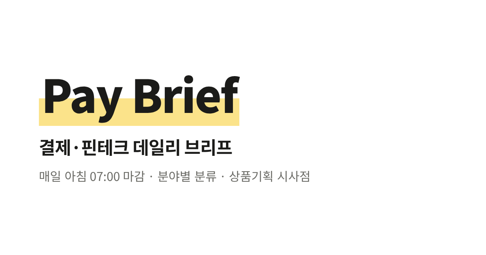
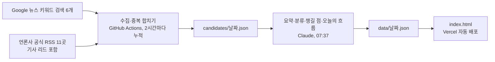

# Pay Brief — 결제·핀테크 데일리 브리프

결제·핀테크 뉴스를 매일 아침 07:00 마감으로 모아 중복을 걸러내고, 기사마다 **요약 + 상품기획팀이 검토할 점(시사점)**을 붙여 한 페이지로 보여 주는 서비스.

- 라이브: https://briefpage-tau.vercel.app
- 역할: 기획 · 요구사항 정의 · 데이터 파이프라인 설계 · 운영 (1인 프로젝트, 구현은 Claude Code와 협업)



## 왜 만들었나

결제·PG·정산·스테이블코인·AI 에이전트 결제 쪽 뉴스는 매일 수십 건씩 나오지만, 같은 발표를 다룬 기사가 제목만 바꿔 여러 번 올라오고 홍보성 기사도 섞여 있다. 상품기획자가 아침에 필요한 건 기사 목록이 아니라 다음 세 가지다.

1. **오늘 볼 만한 것만** — 중복·무관 기사 제거
2. **분야별로 나눠서** — 결제·PG / 정산·송금 / AI·에이전트 / 규제·정책 / 경쟁사·시장
3. **"그래서 우리는 뭘 검토해야 하나"** — 기사마다 시사점 1문장

## 동작 방식



| 단계 | 하는 일 |
|---|---|
| 수집 | Google 뉴스 키워드 검색(폭넓게) + 언론사 공식 RSS(기사 리드 포함). 언론사 RSS는 전 분야가 섞여 있어 결제 핵심어로 한 번 더 거른다 |
| 누적 | 2시간마다 돌며 그날 후보 파일에 더한다. GitHub 예약 실행이 몇 시간 늦어져도 07:00 마감 때는 이미 대부분 모여 있다 |
| 중복 합치기 | ① 링크 ② 제목 앞 30자 ③ 제목 2글자 조각 60% 겹침 또는 같은 주어 + 35% 겹침. 같은 기사면 **리드가 있는 언론사 버전**을 남긴다 |
| 요약 | 리드가 있으면 2~3문장, 없으면 제목으로 알 수 있는 사실만 1문장. 기사마다 "챙길 점" 1문장, 중요도 1~3 |
| 오늘의 흐름 | 그날 기사 전체를 묶어 한 줄 제목 + 흐름 3개 |
| 화면 | 오늘의 흐름 → 먼저 읽을 기사 3건 → 분야별 기사. 지난 호 선택 |

요약 규칙(독자, 문장 길이, 좋은 예·나쁜 예, 중요도 기준)은 `scripts/build-brief.js`의 `EDITORIAL_RULES`에 한 곳으로 모아 두었다. 예약 작업이 직접 쓸 때와 API로 쓸 때 같은 규칙을 쓴다.

## 기획에서 정한 것들

- **"하루치"의 정의**: 브리프 D = 전날 07:00 ~ D 07:00 (KST). 출근 전에 읽는 아침 브리프라 내용은 대부분 전날 낮~저녁 기사다.
- **양보다 정리**: 하루 후보 최대 40건, 출처별 최대 6건. 같은 사건은 1건으로 합치고 무관·중복 기사는 요약 단계에서 한 번 더 뺀다.
- **"챙길 점"은 행동으로**: "수요를 확인할 필요" 같은 일반론 대신, 오늘 무엇을 비교·확인·준비할지 쓴다.
- **저작권**: 기사 본문은 싣지 않는다. 리드는 요약 재료로만 쓰고 화면에는 제목·링크·자체 요약만 보여 준다.
- **API 키 없이도 운영**: 수집은 GitHub Actions, 요약은 Claude 예약 작업. 저장소 시크릿에 `ANTHROPIC_API_KEY`가 있으면 Actions가 요약까지 혼자 끝낸다.

## 운영하며 고친 문제 (트러블슈팅)

### 1. 아침 브리프인데 밤 기사가 올라왔다 (2026-11-21)
- **현상**: 첫 브리프의 생성 시각이 23:18이었고, 기사도 그날 오후~저녁 것뿐이었다.
- **원인**: 수집 구간이 "실행 시각부터 24시간 전까지"라 실행 시각에 따라 내용이 바뀌었고, 브리프 날짜도 실행일로 붙었다.
- **해결**: 수집 구간을 07:00 마감으로 고정했다. JSON에 실제 수집 구간(`window`)을 저장하고 화면에 "11.18 07:00부터 23:18까지 나온 기사"처럼 표시했다. 기존 파일은 새 기준에 맞춰 11/19자로 옮겼다.

### 2. 매일 '성공'인데 브리프가 안 쌓였다 (2026-11-21)
- **현상**: 예약 작업은 매일 성공으로 끝나는데 11/18 이후 새 브리프가 없었다.
- **원인**: 예약 작업이 도는 클라우드 환경이 보안상 허용 목록에 없는 사이트를 막고 있었고, Google 뉴스도 막혀 있었다. 수집 0건이면 조용히 끝내도록 해 둬서 실패가 성공처럼 보였다.
- **해결**:
  - 모든 피드가 실패하면 "0건"이 아니라 오류로 끝나게 해서 실패가 드러나게 했다.
  - 인터넷이 열린 **GitHub Actions가 수집**하고 Claude는 **요약만** 하도록 역할을 나눴다.

### 3. 수집은 됐는데 요약이 비어 있었다 (2026-11-23)
- **현상**: 07:03 예약 수집이 11:08에야 돌아 07:37 요약 작업이 후보 없이 끝났다. 받아 온 12건도 기사 설명이 모두 비어 있었다.
- **원인**: GitHub 예약 실행은 몇 시간씩 밀릴 수 있다. Google 뉴스 RSS는 설명란에 제목만 반복한다.
- **해결**:
  - 수집을 2시간마다 돌려 후보를 누적하고, 요약 작업은 07:37·09:37·11:37에 확인해 아직 없을 때만 만든다.
  - 언론사 공식 RSS 17곳을 GitHub Actions에서 시험해 응답과 리드 포함 여부를 확인하고, 11곳을 출처로 추가했다.
  - 요약 규칙을 독자·문장 길이·좋은 예/나쁜 예·중요도 기준까지 구체화하고, 하루 흐름 요약을 더했다.
  - 화면을 대시보드형에서 한 단으로 읽는 뉴스레터형으로 바꿨다. 반나절만 수집된 11/19 테스트분은 내렸다.

## 직접 실행

```bash
npm install
npm run brief:collect                       # 수집·중복 제거 결과만 콘솔에 (API 키 불필요)
node scripts/build-brief.js --date 2026-11-21 --candidates work/c.json   # 특정 날짜 후보 저장
export ANTHROPIC_API_KEY=sk-ant-...
npm run brief                               # 수집 + 요약 + 저장 한 번에 (모델 claude-haiku-5-5)
npm run serve                               # http://localhost:8000
```

자동 실행:
- `.github/workflows/collect.yml` — 2시간마다 오늘자·내일자 후보를 `candidates/`에 누적. 시크릿에 `ANTHROPIC_API_KEY`가 있으면 07시 이후 요약까지 해서 `data/`에 저장. Actions 탭의 **Run workflow**로 날짜를 골라 수동 실행할 수 있다.
- Claude Code 예약 작업 — 07:37·09:37·11:37에 `data/오늘.json`이 없으면 `candidates/오늘.json`을 읽어 요약을 쓰고 `--assemble`로 저장해 push.

## 수집 출처

언론사 RSS: 머니투데이, 파이낸셜뉴스(금융), 전자신문, 블로터, 디지털투데이, 서울파이낸스, 지디넷코리아, 뉴스핌, 바이라인네트워크, 블록미디어, 매일경제(증권·금융). 2026-11-23 시험에서 한국경제(설명 없음), 디지털데일리(0건), 아이뉴스24·전자신문 금융(404)은 제외했다.

Google 뉴스 키워드: `간편결제`, `PG사`, `정산 결제`, `스테이블코인 결제`, `AI 에이전트 결제`, `금융위원회 핀테크`

- 세계파이낸스 RSS는 HTTPS 인증서 불일치·DNS 실패로 제외 (2026-11-18)
- `PG사 OR 전자결제대행` → `PG사`, `정산 핀테크` → `정산 결제`로 교체: 24시간 기사 0건인 날이 많았음
- Google 뉴스 RSS의 설명은 제목+언론사명뿐이라, 언론사 RSS와 겹치지 않는 기사는 제목 위주로 1문장 요약된다.

## 다음에 할 것

- 아침 메일(뉴스레터) 발송 — 같은 `data/` JSON을 메일 본문으로 사용
- 리드가 있는 기사 비율 높이기 — 결제 전문 매체 RSS 추가
- 키워드별 수집량·중복률·무관 비율을 기록해 키워드 조정 근거로 쓰기
- 지난 브리프 검색, 분야별 주간 요약

## 저작권

기사 원문의 저작권은 각 언론사에 있습니다. 이 페이지는 제목·링크와 자체 요약만 제공합니다.
